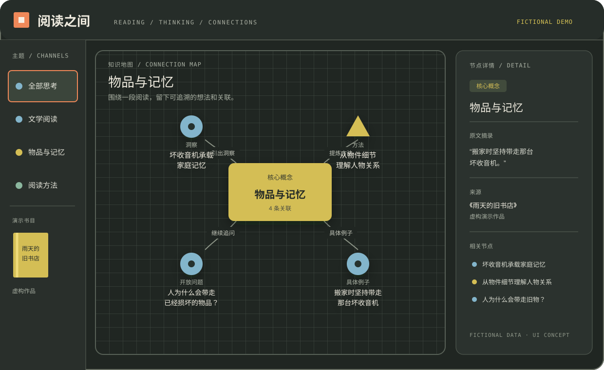

# 阅读之间 · Reading Between

**让阅读对话里的思考、新知与疑问，成为可以继续探索的知识地图。**

一个本地优先的个人 MCP 插件实验。你在支持 MCP 的 AI 客户端里讨论阅读，宿主模型提炼有价值的内容、寻找既有联系，再调用工具保存。内置可视化地图，用于查看原话、关联依据、编辑和撤销。



*虚构演示数据：一段阅读内容如何延伸出洞察、方法、开放问题与例子。*

> 当前为早期内测版。无需额外模型 API Key；AI 推理使用宿主客户端自己的能力和额度。插件本身不会监听所有聊天，也不保证每轮都自动调用。自动捕捉取决于宿主、启用的工作流和工具选择。

## 能做什么

- 保存个人洞察、新知、问题、阅读方法和具体例子。
- 区分用户观点、AI 解释和外部知识；保留原话作者、来源与不确定性。
- 使用有理由的关联，表达类比、支持、补充、挑战、修正等关系。
- 在 MCP Apps 地图中探索、编辑、归档、撤销最近一次修改。
- 用 SQLite 在本机持久保存；服务重启后保留数据。
- 检测版本冲突，避免并发覆盖；重试相同请求不会重复保存。

检索目前采用关键词匹配，不使用向量模型。语义关联由宿主模型判断，不由后端自动生成。

## 运行要求

- Python 3.11 或更新版本。
- 能启动本地 stdio MCP 服务的客户端；可选使用 Codex CLI 配置连接。
- 显示内置地图需要支持 MCP Apps。**能调用 MCP 工具，不等于客户端一定能显示地图。** 不支持界面的客户端仍可使用读写工具。

## 安装（macOS / Linux）

下载本仓库 ZIP 并解压，或克隆到本地。进入项目目录，在终端执行：

```bash
python3 scripts/install_local.py --connect-codex
```

这会创建项目内的 `.venv`、安装依赖，并显式尝试注册本地 Codex MCP 服务。需要本机已安装 Codex CLI，且配置目录可写。它不会替你在 ChatGPT 网页中创建插件连接。

如果只安装依赖、稍后手动配置：

```bash
python3 scripts/install_local.py
```

参考生成的 `mcp.local.json`，把服务命令加入你的客户端。不要将这个文件提交到 GitHub，它包含当前机器的绝对路径。

Windows 同样可使用安装脚本；下面文档里的 `.venv/bin/python` 需换成 `.venv/Scripts/python.exe`。Windows 客户端行为尚未单独验收。

## 开始使用

在启用这个 MCP 服务的新对话中说：

> 使用阅读之间。接下来的阅读讨论中，主动记录有价值的思考、新知和问题，查找已有相关内容并建立有依据的关联。保留我的原话，区分我的观点与 AI 解释，不要逐条问我是否记录。需要时打开知识地图。

完整的工作流说明在 [docs/WORKFLOW.md](docs/WORKFLOW.md)。它是推荐给宿主的行为规则，不是保证后台自动运行的监听器。

随后正常讨论。例如（以下作品与对话均为虚构）：

> 我在读《雨天的旧书店》。人物搬家时坚持带走那台坏收音机，我想到它可能承载家庭记忆，不一定只是经济价值。

需要查看时说“打开我的知识地图”，或“找找以前聊过的物品与记忆”。让客户端使用 `get_knowledge_map` 和 `find_related`。

## 试用演示数据

`assets/sample-reading.json` 是完全虚构的样例，不含真实聊天分享链接或作者个人资料。只在空数据库中导入：

```bash
.venv/bin/python scripts/reading_cli.py capture < assets/sample-reading.json
```

如果已有数据，先读取地图并处理修订号与节点 ID，不要直接改样例的修订号强行导入。

## 数据、隐私与费用

- 默认数据库：`~/.local/share/reading-between/reading.sqlite3`。
- 用 `READING_BETWEEN_DATA_DIR` 指定数据目录；在插件宿主提供时，也支持 `PLUGIN_DATA`。
- 本服务不调用模型 API、不上传数据库、不读取整段 ChatGPT 历史。宿主平台如何处理对话，取决于其产品设置。
- 不在不同电脑或用户之间自动同步。
- `archive_reading_node` 是可撤销的归档，不是永久删除；历史里仍保留内容。
- 停止服务后备份 SQLite 文件可保留完整历史；CLI JSON 导出是快照，不包含全部历史正文。
- 当前无多用户账号、身份认证或公共云部署。不要公开暴露这个单人数据库服务。

## MCP 工具

| 工具 | 作用 |
|---|---|
| `get_knowledge_map` | 返回真实地图、修订号、最近修改，并关联界面资源 |
| `find_related` | 通过关键词寻找已有笔记候选 |
| `capture_reading_batch` | 原子保存节点、关系和来源 |
| `revise_reading_node` | 编辑整理，保留原话与来源 |
| `archive_reading_node` | 可逆归档并隐藏关联 |
| `undo_reading_change` | 撤销最新一次修改 |

## 测试与当前边界

```bash
.venv/bin/python scripts/test_plugin.py
```

测试涵盖持久化、冲突、原子回滚、幂等、来源、编辑、归档、撤销，以及真实 stdio MCP 握手、工具调用、界面资源读取和跨进程重读。CI 运行同一套测试。

地图组件还经过模拟 MCP Apps 宿主下的加载、编辑保存、撤销、列表切换及输入转义测试。不同客户端对内置地图的兼容性需各自验证。项目作者已反馈在自己的安装环境中试用可行；这不等于支持所有客户端。

本仓库不是已上架的 ChatGPT 插件目录条目。ChatGPT Work 的远程连接另需客户端支持的私有隧道或经过认证的部署，不能仅上传 Python 文件完成安装。

## 卸载

如果用安装脚本注册了默认服务：

```bash
codex mcp remove reading-between
```

再移除项目目录。数据库默认位于用户数据目录，卸载代码不会删除它；如需永久清除，请先自行备份，再删除该数据库文件。

## 反馈与贡献

欢迎通过仓库 Issues 报告：安装环境、客户端、操作步骤、预期和实际结果。请使用脱敏样例，不要上传私人阅读数据库、令牌或完整私人对话。

本项目采用 [MIT License](LICENSE)。源码、示例与 UI 不包含第三方品牌标志或参考产品素材。
